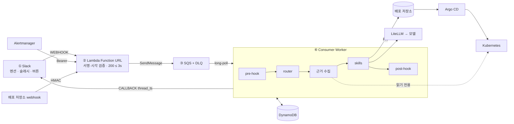

# Slack 비동기 LLM 워커 · 장애 대응 ChatOps

「Slack 요청을 큐로 받아 LLM 워커가 처리하는 구조」 설계의 **단순화안(Lambda → SQS → Worker)**을 구현하고, 워커의 skills 단계를 장애 대응 도구로 채웠습니다. 장애 알림이 오면 Pod 상태·이벤트, 배포 이력, Argo CD 상태를 모아 한 메시지로 보여 주고, 배포가 원인으로 보이면 **되돌리기 Pull Request**를 제안합니다. 봇은 클러스터를 읽기만 하고, 변경은 사람이 승인한 PR을 Argo CD가 반영합니다.

**현재 상태:** 모든 검증은 로컬입니다. AWS 리소스는 Terraform으로 정의해 LocalStack에 적용했고, 실행 대상은 kind 클러스터와 Argo CD, 배포 저장소는 Gitea, LLM 게이트웨이는 LiteLLM 컨테이너, Slack은 모의 서버입니다. **실제 AWS·EKS·GitHub·Slack·Bedrock에는 배포하거나 호출하지 않았습니다.**

## 구성



설계 요소별 대조와 바꾼 판단은 [design-mapping.md](docs/design-mapping.md)에 있습니다. 설계에서 바꾼 것은 세 가지입니다.

- **Slack 재시도:** 재시도를 버리지 않고 큐에 넣습니다. 중복은 워커가 DynamoDB 조건부 쓰기로 제거합니다.
- **DLQ 기준:** 3회 대신 수신 8회입니다. SQS는 실패가 아니라 수신을 세기 때문입니다.
- **RAG와 Vector DB:** 넣지 않았습니다. 장애 대응에 필요한 근거는 검색이 아니라 조회로 얻습니다.

## 주요 기능

| 기능 | 동작 |
|---|---|
| 알림 → 근거 | Alertmanager 알림에 Pod 상태·종료 코드, Warning 이벤트, 최근 이미지 태그 변경(커밋·시각·작성자), Argo CD 상태, 런북 링크를 붙여 게시. LLM은 근거 요약만 함 |
| 되돌리기 PR | 크래시 알림 + 알림 2시간 이내 태그 변경 + 실패 Pod가 그 태그일 때만 버튼 표시(규칙, LLM 아님). 클릭하면 봇이 PR을 열고, 다른 사람이 승인·merge |
| 반영 후 확인 | merge webhook을 받아 Argo CD Synced/Healthy, 새 이미지 Pod Ready, 재시작 0회를 확인해 스레드에 결과 |
| 상태 변경 제어 | 클릭 직전 배포 브랜치를 다시 확인하고, PR 대기 중 새 배포가 생기면 필수 상태 검사를 실패로 바꿔 merge를 막음 |
| `/ops pipeline` | 음성 처리 단계별 큐 대기·처리 중·DLQ·Pod 상태를 한 메시지로 |
| `/ops status`, `/ops restart` | Deployment 조회, 승인 후 재시작(GitOps 대상이 아닌 워크로드용 보조 기능) |
| 질의응답 | `@bot 질문`에 LLM 답변. `@bot kb 질문`은 승인 문서 키워드 검색(벡터 검색 아님) |
| 진행 표시 | 워커가 요청을 맡으면 👀 리액션 |

## 검증 결과

| 단계 | 내용 | 기록 |
|---|---|---|
| 0 | 모의 큐·SQLite로 상태 전이와 실패 처리. 단위 테스트 125개 | [verification.md](docs/verification.md) |
| 1 | LocalStack + Terraform으로 수신부터 답글까지: 중복 전달, Slack 429, 전송 후 timeout, DLQ | [localstack-verification.md](docs/localstack-verification.md) |
| 2 | LiteLLM: 서비스별 키, 인스턴스 간 공유 호출 제한, Redis 장애, 예산, 게이트웨이 중단 중 재시도 | [gateway-verification.md](docs/gateway-verification.md) |
| 3 | AWS 리소스 대응, 비용 가정, 로컬로 증명하지 못한 것 | [aws-deployment.md](docs/aws-deployment.md) |
| 4 | ChatOps: 승인, 실행 기록, RBAC, 파이프라인 조회, 재시작 후 복구 확인, LLM 제안 측정 | [chatops-verification.md](docs/chatops-verification.md) |
| 5 | GitOps 되돌리기: 6/30 실제 장애를 본뜬 시나리오 | [gitops-verification.md](docs/gitops-verification.md) |

주요 결과(로컬 기준):

- **배포 원인 크래시:** 알림 메시지에 "이미지 prod-aa314fc → prod-6e134f1, 알림 직전 커밋"과 "exit 1, CrashLoopBackOff"가 함께 표시됨 → 되돌리기 PR → 승인·merge → 스레드에 복구 확인
- **봇의 권한:** 봇 토큰으로 merge 시도 시 405 거부. 클러스터 쓰기 권한 없음
- **중복 실행 방지:** 버튼 3회 동시 클릭에 PR 1개. 같은 이벤트 3회 전달에 답글·모델 호출 1회
- **상태 변경 제어:** 알림 뒤 hotfix가 배포됐으면 PR을 만들지 않음. PR 대기 중 새 배포가 생기면 1.4초 만에 merge 차단과 보류 알림
- **원인이 배포가 아닌 경우:** 노드 부족 Pending에는 근거(Insufficient cpu)만 보여 주고 되돌리기는 제안하지 않음
- **게이트웨이 장애:** 45초 중단 중에도 모든 작업 처리. 모델에 닿지 않은 실패는 재시도 횟수를 소모하지 않음(소모 오류 5건 → 0건)

## 실패에 대한 동작

| 상황 | 동작 |
|---|---|
| 서명 불일치, ±5분을 벗어난 요청 | 거부 |
| Slack 재시도, SQS 재전달 | 큐에 넣고 워커가 DynamoDB 조건부 쓰기로 한 번만 실행 |
| 모델에 닿지 않은 실패(연결 거부, 게이트웨이 429) | 재시도 횟수를 돌려주고 15~300초 간격으로 재시도 |
| 모델 timeout·5xx | 모델이 실행됐을 수 있어 시도 소모(작업당 최대 2회) |
| 모델 성공 후 Slack 429 | 저장한 결과 재사용, 모델 다시 호출하지 않음 |
| Slack이 받았을 수도 있는 실패 | AMBIGUOUS로 격리, 자동 재전송 중지 |
| 되돌리기 PR 생성 중 실패 | 브랜치·커밋·PR 모두 이미 있으면 재사용하므로 재시도해도 PR 1개 |
| merge 후 복구 실패 | "복구 안 됨"과 상태를 스레드에 남기고 사람에게 넘김 |

**Exactly-once 답글을 보장하지 않습니다.** 전송 결과가 불확실하면 중복 답글보다 답변 누락 쪽을 택하고 사람이 확인합니다.

## 재현

필요한 것: Docker, Terraform 1.6 이상, [lstk](https://docs.localstack.cloud/)(LocalStack 로그인), kind, kubectl, Ollama, Python 3.12. AWS 계정은 필요 없습니다.

```bash
python3 -m venv .venv && .venv/bin/pip install -r requirements-test.lock
.venv/bin/python -m pytest -q

scripts/local_up.sh --burst 5 --duplicates 2 --observe 5      # LocalStack + Terraform + 기본 시나리오
docker compose -f gateway/compose.yaml --profile scale up -d && .venv/bin/python gateway/setup_keys.py
.venv/bin/python e2e/run_gateway.py                             # 게이트웨이 시나리오
scripts/kind_up.sh && .venv/bin/python e2e/run_chatops.py       # ChatOps 시나리오
scripts/gitops_up.sh && .venv/bin/python e2e/run_gitops.py      # GitOps 되돌리기 시나리오

kind delete cluster --name slack-ops; docker rm -f slack-ops-gitea
docker compose -f gateway/compose.yaml --profile scale down; lstk stop
```

## 안전장치

- 봇은 GitOps 대상 클러스터를 읽기만 합니다(읽기 전용 ClusterRole). 변경은 배포 저장소의 PR로만 하며, main 보호 규칙상 다른 사람의 승인 없이 merge되지 않습니다.
- 원격 모델 엔드포인트와 Bedrock은 `ENABLE_PAID_MODEL=approved` 없이는 시작하지 않습니다.
- 로컬 Terraform 환경은 LocalStack 고정 계정(`000000000000`)에만 적용됩니다.
- Slack API 주소는 slack.com과 loopback만 허용합니다.
- 로그에는 질문 원문, 토큰, `response_url`, 오류 메시지를 남기지 않습니다. 오류는 클래스와 상태 코드만 남깁니다.

## 팀이 Discord를 쓰는데 왜 Slack인가

현업 표준에 맞춰 Slack으로 구현했습니다. Discord의 상호작용도 3초 안에 응답해야 해서 같은 구조가 그대로 맞습니다. 메신저에 묶인 부분은 수신 단계(서명·이벤트 형식)와 답글 전송뿐이고, 큐·워커·근거 수집·되돌리기 PR은 바꿀 필요가 없습니다.

## 문서

- [설계 대비 구현](docs/design-mapping.md)
- [아키텍처 결정](docs/architecture.md): 상태 전이, fencing, 보장 범위
- [운영·보안](docs/operations.md), [AWS 배포 구성과 비용](docs/aws-deployment.md)
- [포트폴리오용 사실 정리](docs/portfolio-facts.md)
