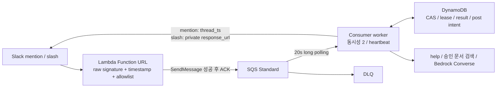

# Slack 비동기 LLM 워커

Slack의 짧은 수신 응답 제한과 오래 걸리는 모델 실행을 분리하고, 재전달·워커 중단·답글 전송 실패를 재현하는 독립 구현입니다. 기존 UtterAI 저장소는 수정하지 않았습니다.

**현재 상태:** Python 구현 및 로컬 검증 완료. AWS/Slack/Bedrock 실서비스 검증, 컨테이너 빌드, CloudFormation 배포, GitHub 업로드는 미실행입니다. 이 저장소의 실험에서 모델과 Slack은 명시적인 테스트 대역입니다.

## 최소 구성



FastAPI는 현재 넣지 않습니다. Slack 하나의 입력을 정규화하는 데 별도 API 서버, 내부 인증, 타임아웃과 배포 단위를 추가할 필요가 작습니다. 정규화 코드는 함수로 분리했으므로 이후 여러 입력 채널과 조회 API가 생기면 서비스로 분리할 수 있습니다.

| 기준 | Lambda → FastAPI → SQS | Lambda → SQS, 이번 선택 |
|---|---|---|
| 단순성 | 서버·내부 인증·배포·장애 경로 추가 | 수신 함수와 소비자만 배포 |
| 운영 비용 | 기존 API를 재사용하면 추가 비용이 작을 수 있음. 신규 상시 서버/로드밸런서는 유휴 비용 발생 | 수신은 요청 단위. 소비자·상태 저장·네트워크 비용은 여전히 발생 |
| 확장 | 웹/크론/메신저·상태 조회를 한 API로 통합하기 쉬움 | Slack만 처리하기에 충분. 공통 Job 스키마 재사용 가능 |
| 신뢰성 | 서버 하나를 추가한다고 중복·유실이 해결되지는 않음 | ACK 시점·CAS·전송 불명확 상태를 별도로 설계 |

이는 구성 요소를 줄인 설계 판단이며, 비용 절감액을 측정한 결과는 아닙니다.

## 빠른 재현: 외부 계정·비용 없이

Python 3.12 기준입니다. 아래 설치는 패키지 저장소 접근이 필요하며 AWS/Slack 계정은 사용하지 않습니다.

```bash
python3 -m venv .venv
source .venv/bin/activate
python -m pip install -r requirements-test.lock
python -m pytest -q
python -m slack_worker.demo --output evidence/http-burst-local.json
```

데모는 잠시 `127.0.0.1`의 임시 포트에서 HTTP를 받고 종료합니다. 100개 이벤트를 각각 두 번 전송한 뒤 큐를 처리합니다. 동시 사용자 100명 부하 시험은 아닙니다. 로컬 포트가 차단된 실행 환경에서는 포트 사용 허용이 필요합니다.

2026-10-27 검증 결과는 [실험 기록](docs/verification.md), 원시 데이터는 [evidence/http-burst.json](evidence/http-burst.json), [JUnit](evidence/tests.xml)에 있습니다. CI 설정은 포함했지만 GitHub에서 실행되지는 않았습니다.

## 실패에 대한 동작

| 상황 | 구현 동작 |
|---|---|
| 서명 불일치 / ±5분을 벗어난 요청 | 거부. 원문 바이트로 HMAC-SHA256 확인 |
| Slack 최초 전송 실패 후 재시도 | 재시도 헤더만으로 버리지 않고 다시 큐 적재 시도 |
| 큐 적재 오류·결과 불명확 | 503 반환. 중복 적재는 허용하고 소비자에서 제거 |
| 동일 이벤트 동시 전달 | DynamoDB 조건부 쓰기와 소유권 lease로 실행 조정 |
| 모델 성공 후 Slack 429 | 결과 재사용. Retry-After 후 재전송. 모델 다시 호출하지 않음 |
| Slack 성공 후 SQS 삭제 실패 | SENT 상태를 읽고 재전달 메시지만 삭제 |
| Slack이 받았을 수도 있는 timeout/5xx | AMBIGUOUS로 격리. 자동 재전송 중지 |
| POSTING 저장 후 워커 사망 | lease 만료 후 AMBIGUOUS. 실제 전송 전 사망했으면 답글이 없을 수 있음 |
| 모델 오류 / 중단 후 복구 | 작업당 최대 2회 파이프라인 시도. SDK 자동 재시도 없음 |
| 잘못된 큐 메시지 / 영구 실패 | 임의 삭제하지 않음. SQS 수신 횟수 제한 후 DLQ |

**Exactly-once 답글을 보장하지 않습니다.** Slack 전송과 DynamoDB 쓰기는 하나의 트랜잭션이 아닙니다. 중복 답글을 피하기 위해 전송 결과 불명확 시 가용성을 양보하며, 사람이 확인해야 합니다. `client_msg_id`나 FIFO의 짧은 중복 제거 창을 전 구간 보장으로 취급하지 않습니다.

## 처리 기능과 범위

- `@bot help` 또는 `/ask help`: 모델 없는 도움말 도구.
- `@bot kb 질문`: 승인된 `.md` 문서에서 키워드 겹침으로 최대 두 문서를 찾은 뒤 모델에 전달. 외부 문서 수집·임베딩·벡터 DB는 구현하지 않았습니다.
- 그 외: `Bedrock Converse` 1회, 최대 출력 700 tokens. 입력 4,000자, 문서 문맥 6,000자, 최종 답글 원문 3,000자 제한.
- 입력 단계와 워커에서 workspace/channel/user 허용 목록을 확인합니다. 봇 이벤트를 무시합니다.
- 멘션은 기존 `thread_ts` 또는 해당 메시지 `ts`에 답합니다. 슬래시 커맨드는 원본 메시지 `ts`가 없으므로 `response_url`로 비공개 답변합니다. 임의로 공개 채널 답글로 바꾸지 않습니다.
- Slack 텍스트는 마크업과 멘션 구문을 이스케이프하고 링크 미리보기를 끕니다. 외부 코드 실행 도구는 없습니다.

## 실제 실행 준비

- Lambda 진입점: `slack_worker.runtime.lambda_handler`
- 워커: `python -m slack_worker.runtime`
- [Slack manifest](examples/slack-manifest.yaml), [환경 변수 예제](examples/worker.env.example)
- [리소스 템플릿](infra/cloudformation.json): 검토용. 실행하면 유료 리소스와 공개 수신 URL을 생성합니다. 이번 작업에서는 실행하지 않았습니다.
- [운영·보안·비용·승인 항목](docs/operations.md), [기존 UtterAI 코드 조사](docs/existing-code.md), [아키텍처 결정](docs/architecture.md)

워커는 `ENABLE_PAID_MODEL=approved`와 명시적인 모델 ID 없이는 유료 실행을 시작하지 않습니다. 이 값은 사람의 승인을 기록하는 절차를 대신하지 않습니다. 최초 실서비스 시험은 별도 sandbox·테스트 채널·단일 워커로 진행해야 합니다. 모델 품질·cold start·실측 비용·IAM 및 네트워크는 승인 후 검증 항목입니다.

GitHub에 게시할 때는 이 폴더만 새 저장소로 가져가세요. 개인 PDF·기존 저장소·AWS 키·실제 `.env`는 포함하지 않습니다. 공개 저장소 생성과 push는 수행하지 않았습니다.
