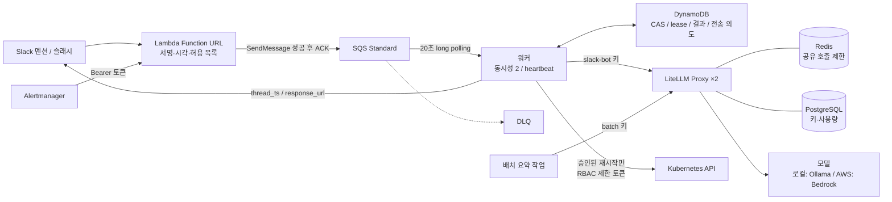

# Slack 비동기 LLM 워커

Slack 요청 수신과 오래 걸리는 LLM 실행을 큐로 분리하고, 여러 서비스가 함께 쓰는 LLM 게이트웨이를 앞에 둔 구성입니다. 그 위에 장애 알림을 받아 상태를 조회하고, 다른 팀원의 승인을 받아 재시작하는 ChatOps 기능을 붙였습니다. 재전달, 워커 중단, 답글 전송 실패, 게이트웨이·Redis 장애, 승인 버튼 연타, 실행 중 워커 종료를 재현해 동작을 확인했습니다.

**현재 상태:** AWS 리소스는 Terraform으로 정의하고 LocalStack에 적용해 끝까지 검증했습니다. LLM 게이트웨이(LiteLLM)는 로컬 컨테이너로, ChatOps 실행 대상은 kind 로컬 Kubernetes 클러스터로 검증했습니다. **실제 AWS·Slack·Bedrock에는 배포하거나 호출하지 않았습니다.** AWS에서 쓸 리소스와 비용 가정은 [AWS 배포 구성](docs/aws-deployment.md)에 정리했습니다.

## 구성



| 계층 | 로컬 검증 | AWS 대응 |
|---|---|---|
| 수신·큐·상태 | LocalStack(Lambda, SQS, DynamoDB, Secrets Manager) | 같은 Terraform 모듈 |
| 워커 | 호스트 프로세스 | ECS Fargate |
| 게이트웨이 | LiteLLM ×2 + PostgreSQL + Redis(docker compose) | Fargate ×2 + 내부 ALB + RDS + ElastiCache |
| 모델 | Ollama(`fast`, `quality`, `embed` 별칭) | Bedrock. 별칭만 바꿈 |
| ChatOps 실행 대상 | kind 클러스터 + ServiceAccount 토큰 | EKS + access entry(워커 태스크 역할 → Kubernetes 그룹) |

## 검증 결과

| 단계 | 내용 | 기록 |
|---|---|---|
| 0 | 모의 SQS·SQLite·테스트 대역으로 상태 전이와 실패 처리 검증. 단위 테스트 110개(현재 기준) | [verification.md](docs/verification.md) |
| 1 | LocalStack + Terraform으로 수신부터 답글까지 연결. 100건 burst, 중복 전달, Slack 429, 전송 후 timeout, DLQ | [localstack-verification.md](docs/localstack-verification.md) |
| 2 | LiteLLM 게이트웨이: 서비스별 키, 인스턴스 간 공유 호출 제한, Redis 장애, 예산, 게이트웨이 중단 중 재시도 | [gateway-verification.md](docs/gateway-verification.md) |
| 3 | AWS 리소스 대응, 비용 가정, 로컬로 증명하지 못한 것 | [aws-deployment.md](docs/aws-deployment.md) |
| 4 | ChatOps: 알림 연동, 파이프라인 상태, 2인 승인 재시작, 복구 확인, RBAC, LLM 제안 검증 | [chatops-verification.md](docs/chatops-verification.md) |

주요 수치(모두 로컬 환경 기준):

- 고유 이벤트 100건 → 답글 100개, 모델 호출 100회. ACK p50 0.28초, p95 1.05초(LocalStack 왕복)
- 같은 이벤트 3회 전달 × 20건 → 답글 20개, 모델 호출 20회
- 분당 10회 키로 게이트웨이 2대에 30회 요청 → 10회만 통과
- 게이트웨이 45초 중단 → 5개 작업 모두 답변, 시도 소모 오류 5건 → 0건(준비 상태 확인 추가 후)
- 승인 버튼 6회 동시 클릭 → 재시작 1회. 재시작 직후 워커 강제 종료 → 대체 워커가 다시 적용해도 롤아웃 1회
- 재시작 후 큐 대기 수로 복구 판단: 회복하는 소비자는 승인 11초 후 "처리 재개 확인", 계속 멈춘 소비자는 Pod가 정상이어도 "처리 재개 안 됨"
- LLM 조치 제안 13건 중 9건이 런북과 일치. 배포 직후 크래시 3건은 모두 잘못된 재시작 제안 → 사람 승인 없이는 실행하지 않음

## 실패에 대한 동작

| 상황 | 동작 |
|---|---|
| 서명 불일치, ±5분을 벗어난 요청 | 거부. 원문 바이트로 HMAC-SHA256 확인 |
| Slack 재시도 | 재시도 헤더만 보고 버리지 않고 다시 큐에 넣음. 중복은 워커가 제거 |
| 큐 적재 실패·결과 불명확 | 503. Slack이 다시 보냄 |
| 같은 이벤트 동시 전달 | DynamoDB 조건부 쓰기와 lease로 한 워커만 실행 |
| 게이트웨이 연결 거부, 게이트웨이 429, 준비 상태 확인 실패 | 모델에 닿지 않음. 시도 횟수를 돌려주고 15초부터 최대 300초 간격으로 재시도 |
| 401·403, 예산 초과 | 영구 거절. 즉시 FAILED |
| 모델 timeout, 5xx, 응답 중 연결 끊김 | 모델이 실행됐을 수 있음. 시도 소모(작업당 최대 2회) |
| 모델 성공 후 Slack 429 | 저장한 결과 재사용. Retry-After 후 재전송. 모델 다시 호출하지 않음 |
| Slack이 받았을 수도 있는 timeout·5xx | AMBIGUOUS로 격리. 자동 재전송 중지, 사람이 확인 |
| 파싱할 수 없는 큐 메시지 | 삭제하지 않음. 수신 8회 후 DLQ |

**Exactly-once 답글을 보장하지 않습니다.** Slack 전송과 DynamoDB 쓰기는 하나의 트랜잭션이 아닙니다. 전송 결과가 불명확하면 중복 답글보다 답변 누락 쪽을 택하고 사람이 확인합니다.

## 재현

필요한 것: Docker, Terraform 1.6 이상, [lstk](https://docs.localstack.cloud/)(LocalStack 로그인), Ollama, Python 3.12. AWS 계정은 필요 없습니다.

```bash
# 단위 테스트
python3 -m venv .venv && .venv/bin/pip install -r requirements-test.lock
.venv/bin/python -m pytest -q

# 1단계: LocalStack에 Terraform 적용 + 끝까지 시나리오
scripts/local_up.sh                                   # 전체(약 5분)
scripts/local_up.sh --burst 5 --duplicates 2 --observe 5   # 빠른 확인

# 2단계: LiteLLM 게이트웨이(1단계 환경이 떠 있어야 함)
docker compose -f gateway/compose.yaml --profile scale up -d
.venv/bin/python gateway/setup_keys.py
.venv/bin/python e2e/run_gateway.py
.venv/bin/python scripts/batch_digest.py "요약할 문장"

# 4단계: ChatOps(1·2단계 환경이 떠 있어야 함)
scripts/kind_up.sh
.venv/bin/python e2e/run_chatops.py

# 정리
kind delete cluster --name slack-ops
docker compose -f gateway/compose.yaml --profile scale down
lstk stop
```

## 처리 기능과 범위

- `@bot help`, `/ask help`: 모델 없이 도움말
- `@bot kb 질문`: 승인된 `.md` 문서에서 키워드로 최대 두 문서를 찾아 모델에 전달. 임베딩·벡터 DB는 구현하지 않음
- `/ops pipeline`: 음성 처리 단계별 큐 대기·처리 중·DLQ·Pod 상태를 한 메시지로
- `/ops status <대상>`: Deployment·Pod 상태 조회. `/ops restart <대상>`: 다른 운영자의 승인 후 재시작, 파이프라인 단계면 큐 소비 재개까지 확인
- Alertmanager 알림: 알림 채널에 게시, 런북 근거의 LLM 요약과 조치 제안. 제안은 버튼일 뿐 실행은 승인 후
- 그 외: 모델 1회 호출, 최대 출력 700토큰. 입력 4,000자, 문서 문맥 6,000자, 답글 3,000자 제한
- workspace·channel·user 허용 목록을 수신과 워커 양쪽에서 확인. 봇 이벤트 무시
- 멘션은 스레드에 답글, 슬래시 커맨드는 `response_url`로 비공개 답변

## 안전장치

- 원격 모델 엔드포인트와 Bedrock은 `ENABLE_PAID_MODEL=approved` 없이는 시작하지 않습니다. loopback 주소만 예외입니다.
- 로컬 Terraform 환경은 LocalStack 고정 계정(`000000000000`)에만 적용됩니다. 자격증명이 잘못 잡혀도 실제 AWS에 적용되지 않습니다.
- Slack API 주소는 slack.com과 loopback만 허용합니다.
- 로그에는 질문 원문, 토큰, `response_url`, 오류 메시지 전문을 남기지 않습니다. 오류는 클래스와 상태 코드만 남깁니다.

## 문서

- [아키텍처 결정](docs/architecture.md): 상태 전이, fencing, 보장 범위
- [운영·보안](docs/operations.md): 권한, 비밀값, 배포 순서, 장애 대응
- [AWS 배포 구성과 비용](docs/aws-deployment.md)
- [포트폴리오용 사실 정리](docs/portfolio-facts.md)
- [기존 UtterAI 코드 조사](docs/existing-code.md)
