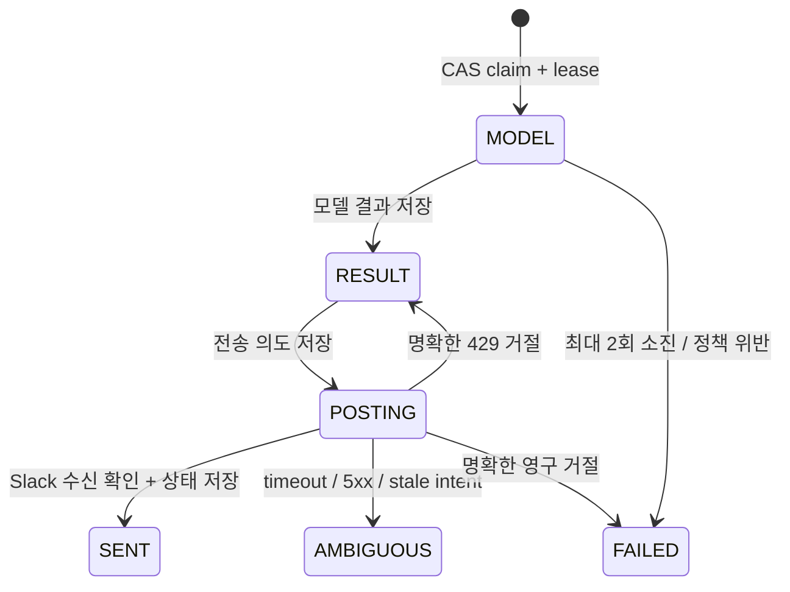

# 설계 결정과 보장 범위

## 원문에서 유지한 것과 변경한 것

기준 자료는 사용자 첨부 `Slack LLM 워커 아키텍처(3).pdf` 3쪽 전체입니다. PDF의 일부 도식은 오른쪽이 잘려 있어, 도식과 설명·비교표의 텍스트를 함께 확인했습니다. 저작권이 있는 원문 파일은 저장소에 복사하지 않았습니다.

유지: Slack → 서명 검증과 빠른 수신 응답 → SQS·DLQ → long polling 소비자 → Slack 응답. hooks/router/검색/도구/모델을 작은 Python 경계로 구분합니다.

수정:

1. **재시도 헤더만으로 폐기하지 않음.** 첫 요청이 SQS 적재에 실패했다면 재시도가 최초 성공 전달일 수 있습니다.
2. **ACK는 큐 적재 확인 뒤.** 200을 먼저 반환하고 함수 종료 뒤에 적재하는 방식은 사용하지 않습니다. SendMessage 성공 응답이 유실되면 큐에 중복이 들어갈 수 있으며 소비자가 이를 감당합니다.
3. **수신 단계에서 별도 중복 처리 기록을 먼저 만들지 않음.** DynamoDB 기록 후 SQS 전송 전 장애의 이중 쓰기 유실 구간을 피합니다. 대가로 중복 SQS 요청 비용은 남습니다. 수신 중복 자체가 비용 문제가 될 정도라면 transactional outbox와 relay 또는 FIFO를 별도 검토합니다.
4. **중복 제거 위치: 워커의 지속 상태.** FIFO의 5분 창이나 프로세스 메모리에 의존하지 않습니다. 표준 큐의 전달 순서는 가정하지 않습니다.
5. **DLQ 기준은 실패 횟수가 아니라 수신 횟수.** 초기 설정 `maxReceiveCount=8`. 429·작업 중 중복 전달도 수신 횟수를 소비합니다. 숫자 3을 그대로 복사하지 않았습니다.
6. **답글 전송 의도와 결과를 별도로 저장.** 전송 결과가 불명확한 작업은 자동 재전송하지 않습니다.

## 상태와 fencing

각 상태는 `rev` 기반 CAS로 갱신합니다. DynamoDB는 consistent read와 조건부 PutItem을 사용합니다. 매번 현재 owner·lease를 확인하므로 lease가 만료되거나 다른 소비자가 인수한 이전 워커는 결과 저장·전송 의도 기록을 진행할 수 없습니다. 모델 실행 중 사망하면 이미 과금된 모델 요청을 새 소비자가 다시 실행할 수 있습니다. 이 비용은 작업당 최대 2회 시도로 제한합니다.

중요한 한계: POSTING 직후 중단되면 실제 전송 여부를 알 수 없습니다. 새 소비자는 자동 전송 대신 AMBIGUOUS를 선택합니다. Slack 수신 후 SENT 저장 실패도 같은 방식으로 격리합니다. 살아 있던 이전 프로세스의 전송이 늦게 끝날 수 있으므로, 운영자는 기존 워커 종료 및 전송 제한 시간을 확인한 뒤 수동 복구해야 합니다. 자동 중복 억제와 답변 누락 가능성 사이의 의도적인 선택입니다.

SENT는 SQS 삭제 실패 후에도 다시 모델·Slack을 호출하지 않습니다. AMBIGUOUS와 FAILED는 자동 삭제하지 않고 DLQ에 도달하게 둡니다. 단순 redrive는 이 상태를 초기화하지 않습니다.

## 시간·동시성과 대기열

- 수신 요청: 원문 서명·±300초 timestamp 확인. 수신 시점 기준 600초보다 오래된 멘션/커맨드는 거부합니다. Slack 지연 이벤트를 무기한 수용하는 모드는 아닙니다.
- ACK: Secrets Manager의 짧은 timeout과 5분 캐시, SQS의 짧은 timeout, SDK 단일 시도. Lambda timeout 3초. **이 설정 자체는 AWS에서 3초 이내 응답했다는 증거가 아닙니다.**
- long poll 20초, SDK read timeout 25초. 슬롯당 한 메시지만 가져옵니다. 배치 prefetch 뒤 순차 처리로 visibility를 낭비하지 않습니다.
- 메시지 visibility 90초, owner lease 60초, heartbeat 10초. SDK 오류가 발생하면 이후 Slack 전송을 막고 소유권 확인에 실패한 작업은 중단합니다. 네트워크 호출이 이미 진행 중이었다면 결과 불명확 정책이 적용됩니다.
- heartbeat는 180초까지만 연장합니다. 모델 read timeout 60초, 자동 재시도 0. 모델이 중간 응답을 계속 보내는 특수한 경우 read timeout은 절대 실행시간 제한이 아니므로, 전체 시간 보장은 별도 프로세스 격리·취소로 강화해야 합니다.
- 초기 워커 1개 × 동시성 2. 한 채널의 Slack 전송 간격은 공유 CAS 예약으로 최소 1.1초를 둡니다. 경쟁 시 해당 슬롯 안에서 최대 약 30초 기다립니다. 알려진 429는 Retry-After로 SQS visibility를 조정합니다.
- 워커 수 증가 시 모델 동시성은 `replicas × concurrency`. 현재 전역 모델 동시성·일일 USD 예산을 중앙 강제하는 구현은 없습니다. 초기 단일 워커 상한을 유지하고, 다중 replica 승인은 별도 토큰 버킷/예산 제어 이후 진행합니다.
- 표준 큐는 요청·답글 순서를 보장하지 않습니다. 대화 이력은 외부에서 읽지 않으며 각 작업은 독립입니다. 다중 턴 순서가 필요하면 채널 전체 대신 thread별 FIFO 그룹과 세션 버전 제어를 검토해야 합니다.

## 검색·도구와 보안 경계

pre-hook 역할은 정책·입력·나이 검증, router는 `help` / `kb ` / 일반 모델 질의 분기입니다. `help`는 결정적 도구이며 모델이 도구를 선택·실행하지 않습니다. 검색은 모든 허용 사용자에게 공개해도 되는 작은 로컬 문서 집합만 사용합니다. 민감 문서나 여러 조직의 문서를 한 corpus에 섞으면 안 됩니다. post-hook은 단일 메시지 크기 제한·안전한 텍스트 전송이며, 모델 응답의 사실성 검증을 뜻하지 않습니다.

문서의 지시문을 신뢰하지 말라는 프롬프트는 보조 수단입니다. 임의 외부 호출·shell 도구·권한 상승 기능을 제공하지 않는 것이 실제 경계입니다. lexical retrieval은 임베딩 검색의 성능·품질을 증명하지 않습니다.

## 공식 근거

2026-10-27 확인. 구현 코드·테스트 결과와 외부 서비스의 보장 범위를 구분합니다.

- [Slack 요청 서명: 원문·timestamp·상수 시간 비교](https://docs.slack.dev/authentication/verifying-requests-from-slack/)
- [Events ACK 및 재전달](https://docs.slack.dev/apis/events-api/)
- [Slash 커맨드의 별도 payload·ACK](https://docs.slack.dev/interactivity/implementing-slash-commands/)
- [response_url 사용 기간과 응답 정책](https://docs.slack.dev/interactivity/handling-user-interaction/)
- [Slack thread_ts·메시지 전송](https://docs.slack.dev/reference/methods/chat.postMessage/)
- [Slack 채널 전송 제한·429](https://docs.slack.dev/apis/web-api/rate-limits/)
- [SQS visibility 및 at-least-once](https://docs.aws.amazon.com/AWSSimpleQueueService/latest/SQSDeveloperGuide/sqs-visibility-timeout.html)
- [SQS long polling](https://docs.aws.amazon.com/AWSSimpleQueueService/latest/SQSDeveloperGuide/sqs-short-and-long-polling.html)
- [DLQ receive count·retention](https://docs.aws.amazon.com/AWSSimpleQueueService/latest/SQSDeveloperGuide/sqs-dead-letter-queues.html)
- [DynamoDB 조건부 쓰기](https://docs.aws.amazon.com/amazondynamodb/latest/developerguide/Expressions.ConditionExpressions.html)
- [Bedrock Converse](https://docs.aws.amazon.com/bedrock/latest/APIReference/API_runtime_Converse.html)
