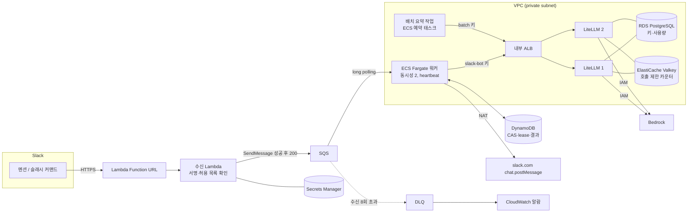

# AWS 배포 구성과 비용 가정 (3단계)

로컬에서 검증한 구성을 AWS에 올릴 때 어떤 리소스로 바뀌는지, 얼마가 드는지, 로컬로는 무엇을 증명하지 못했는지 정리한다. **AWS에는 배포하지 않았다.** `infra/terraform/envs/aws`는 `terraform validate`까지만 실행했다.

## 로컬 구성과 AWS 리소스 대응

| 역할 | 로컬 검증 환경 | AWS 구성 | 같은 코드인가 |
|---|---|---|---|
| Slack 수신·서명 검증 | LocalStack Lambda + Function URL | Lambda(python3.12, 256MB, timeout 3초, 예약 동시성 2) + Function URL(auth NONE) | 같은 Terraform 모듈, 같은 zip |
| 작업 큐 | LocalStack SQS + DLQ | SQS Standard + DLQ(maxReceiveCount 8, SSE) | 같은 모듈 |
| 중복 제거·상태 | LocalStack DynamoDB | DynamoDB 온디맨드(조건부 쓰기, TTL, SSE) | 같은 모듈 |
| 비밀값 | LocalStack Secrets Manager | Secrets Manager(signing secret, bot token, LiteLLM 키) | 같은 모듈. 값만 외부 주입 |
| 워커 | 호스트 프로세스(boto3) | ECS Fargate 서비스(ARM, 0.25 vCPU / 0.5GB, non-root, 읽기 전용 FS) | 같은 이미지·진입점. 태스크 정의만 모듈에 있음, 서비스는 미작성 |
| LLM 게이트웨이 | LiteLLM Proxy ×2 (docker compose) | ECS Fargate 서비스 ×2 + 내부 ALB | 같은 `litellm.yaml`. Terraform 미작성 |
| 키·사용량 저장 | PostgreSQL 컨테이너 | RDS for PostgreSQL | 미작성 |
| 인스턴스 간 호출 제한 공유 | Redis 컨테이너 | ElastiCache Serverless(Valkey) | 미작성 |
| 모델 | Ollama(llama3.2:1b, qwen2.5:3b, nomic-embed-text) | Bedrock Claude Haiku 4.5(질의응답·장애 요약), Titan Embeddings | 별칭(`fast`, `quality`, `embed`)만 바꾼다. 요약도 Haiku로 충분함을 실측([gateway-verification.md](gateway-verification.md#별칭별-모델-선택-측정)) |
| Slack API | loopback 모의 Slack(429·timeout 주입) | slack.com(NAT 또는 기존 외부 경로) | `SLACK_API_BASE`만 다름. 허용 주소는 slack.com과 loopback뿐 |
| 감시 | evidence JSON, 구조화 로그 | CloudWatch Logs, DLQ·대기 시간 알람 2개 | 알람은 모듈에 있음. 알림 대상은 미연결 |
| ChatOps 실행 대상 | kind 클러스터, ServiceAccount 토큰 파일 | 기존 EKS. 워커 태스크 역할을 access entry로 Kubernetes 그룹에 연결하고, 같은 Role(`api`만 patch)을 바인딩 | 워커 코드는 같음. 토큰 공급 방식만 다름(STS 서명 토큰). 미구현 |
| 파이프라인 큐 조회 | LocalStack의 단계별 큐(stt, analysis, report), 소비는 시뮬레이터 | UtterAI 파이프라인의 기존 SQS. 워커 역할에 해당 큐의 `sqs:GetQueueAttributes`만 부여(`pipeline_queue_arns`) | 모듈에 반영. 복구 판단에 CloudWatch 지표를 더하면 더 정확함 |
| GitOps 되돌리기 | Gitea(main 보호), kind의 Argo CD core | GitHub 저장소 + GitHub App(브랜치·PR·커밋 상태 권한만), 기존 Argo CD. webhook 서명은 `X-Hub-Signature-256` 그대로 | 코드는 Gitea API 기준. GitHub용 클라이언트는 미작성 |
| Git webhook 비밀값 | LocalStack Secrets Manager | Secrets Manager(`git_webhook_secret_arn`) | 모듈에 반영 |
| Alertmanager 연동 | 테스트 스크립트가 webhook 호출 | 기존 Alertmanager의 webhook receiver → Function URL `/alertmanager` | Bearer 토큰은 Secrets Manager. 모듈에 반영 |

워커와 게이트웨이의 AWS용 ECS 서비스·ALB·RDS·ElastiCache는 Terraform으로 작성하지 않았다. 비용과 리소스 범위를 보여 주는 설계 단계다.

## AWS 아키텍처

## 월 비용 추정

**측정값이 아니라 가정에 따른 계산이다.** us-east-1 온디맨드 공개 단가로 계산했다. Fargate ARM, Bedrock Claude Haiku 4.5, ElastiCache Serverless Valkey 단가는 2026-10-27 검색으로 대조했고, 나머지는 작성 시점에 알려진 공개 단가다. 배포 전에 대상 리전의 [AWS Pricing Calculator](https://calculator.aws/)로 다시 계산해야 한다. 서울 리전은 대부분 더 비싸다.

가정:

- 하루 1,000건 질문, 월 30,000건
- 요청당 입력 1,500토큰, 출력 300토큰(문서 문맥 포함 추정. 로컬 Ollama 측정값은 모델이 달라 쓰지 않았다)
- 워커 1태스크와 LiteLLM 2태스크가 24시간 상시 실행(730시간)
- 프리 티어 제외, 기존 VPC와 외부 연결 경로 재사용

| 구분 | 리소스 | 계산 | 월 USD |
|---|---|---|---:|
| 모델 | Bedrock Claude Haiku 4.5 | 30,000 × (1,500 × $1 + 300 × $5) / 1M | 90.0 |
| 핵심 경로 | Fargate 워커(ARM 0.25 vCPU / 0.5GB) | 730h × (0.25 × $0.03238 + 0.5 × $0.00356) | 7.2 |
| | Lambda 수신 | 30,000건 × 0.3초 × 0.25GB | 0.1 미만 |
| | SQS | 유휴 long polling 약 52만 회 + 작업 메시지 | 0.3 |
| | DynamoDB 온디맨드 | 작업당 쓰기 6, 읽기 4 | 0.2 |
| | Secrets Manager, CloudWatch Logs·알람 2개 | 비밀 5개 × $0.40, 로그 1GB, 알람 | 2.7 |
| 게이트웨이 | Fargate LiteLLM ×2(ARM 0.5 vCPU / 1GB) | 2 × 730h × (0.5 × $0.03238 + 1 × $0.00356) | 28.8 |
| | 내부 ALB | 730h × $0.0225 + LCU 최소 사용 | 22.3 |
| | RDS PostgreSQL db.t4g.micro(단일 AZ, 20GB) | 730h × $0.016 + 20GB × $0.115 | 14.0 |
| | ElastiCache Serverless Valkey | 최소 저장 100MB 기준 | 6.1 |
| **합계** | | 모델 90.0 + 핵심 경로 약 10.5 + 게이트웨이 약 71.2 | **약 172** |

포함하지 않은 비용: 신규 NAT Gateway(1개 기준 월 약 $33 + 처리량 요금), 퍼블릭 IPv4, ECR 저장, 데이터 전송, Multi-AZ 구성.

### 비용에서 읽히는 것

- **인프라 비용의 약 87%가 게이트웨이 계층이다.** Slack 워커의 핵심 경로(Lambda, SQS, DynamoDB, 워커 1태스크)는 월 약 $10이다. 서비스가 Slack 봇 하나뿐이라면 LiteLLM 없이 워커가 IAM으로 Bedrock을 직접 부르는 편이 싸다.
- **게이트웨이는 쓰는 서비스가 늘수록 의미가 생긴다.** 서비스별 키·허용 모델·호출 제한·예산, 모델 교체 시 애플리케이션 무변경, 사용량 귀속이 한곳에 모인다. 이번 구성은 클라이언트 2개(Slack 워커, 배치 요약)로 이 경계를 보여 준다.
- **줄이는 방법:** LiteLLM을 1태스크로 줄이고 ALB 대신 ECS Service Connect를 쓰면 게이트웨이 계층이 월 약 $28(LiteLLM 1태스크 + RDS)로 내려간다. 인스턴스가 하나라 카운터를 공유할 Redis도 빠진다. 그 대신 게이트웨이 재기동 중에는 호출이 멈춘다. 워커는 이 구간을 "모델에 닿지 않음"으로 분류해 시도를 소모하지 않고 기다린다(2단계 검증).
- **모델 비용은 재시도 정책에 따라 늘어난다.** 모델 실행 여부가 불확실한 실패만 시도를 소모하며 작업당 상한은 2회다. 결과 저장 뒤 Slack 재전송은 모델을 다시 부르지 않는다. 최악의 경우 모델 비용 상한은 위 계산의 2배다.
- **비용 상한 장치:** LiteLLM 예산은 소프트 상한이다(2단계에서 예산의 최대 4.3배 초과 후 차단). Redis 장애 시 호출 제한도 풀린다. 실제 상한은 Bedrock 서비스 할당량, AWS Budgets 알림, Lambda 예약 동시성 2와 워커 동시성으로 함께 정한다.

## 로컬 검증으로 증명하지 못한 것

| 항목 | 로컬에서 본 것 | AWS에서 확인해야 하는 것 |
|---|---|---|
| 3초 ACK | LocalStack 왕복 p95 1.05초 | 실제 Lambda cold start + Secrets Manager 조회 포함 지연 |
| IAM·리소스 정책 | 역할 생성만 확인. LocalStack은 IAM을 강제하지 않음 | 최소 권한으로 동작하는지, 권한 밖 호출이 거부되는지 |
| Slack 재시도 | 재시도 헤더를 붙여 흉내 냄 | 실제 Slack의 재전송 간격과 workspace 단위 429 |
| 모델 | Ollama 소형 모델로 호출 수·실패 분류만 확인 | Bedrock 응답 품질, 지연, `ThrottlingException`이 LiteLLM을 거쳐 429로 바뀌는지 |
| 게이트웨이 재기동 | Docker 포트 전달기의 연결 끊김을 준비 상태 확인으로 처리 | ALB 뒤에서는 502·503 형태. 같은 분류 기준이 맞는지 재확인 |
| Redis 장애 | 전체 중단 시 fail-open | ElastiCache 장애 조치 중 동작 |
| 네트워크 | loopback | private subnet에서 slack.com·Bedrock까지 경로(NAT 또는 VPC 엔드포인트) |
| 비용 | 테스트 단가로 예산 동작만 확인 | 실제 토큰 수와 청구 금액 |
| ChatOps 권한 | kind RBAC으로 `db` patch 거부 확인 | EKS access entry와 IAM 역할을 거친 같은 RBAC 동작, Fargate에서 EKS API까지 네트워크 경로 |
| Slack 버튼 | 서명한 block_actions 요청을 직접 전송 | 실제 Slack 화면, 상호작용 요청 재시도 |
| GitOps 권한 | Gitea 보호 규칙으로 봇의 merge 405 거부 | GitHub branch protection·CODEOWNERS·GitHub App 권한 범위 |
| Argo CD 반영 시간 | 폴링 15초로 단축 | 기본 3분 폴링 또는 webhook. 복구 확인 간격·횟수를 이에 맞춰 조정 |

### 로컬 에뮬레이션이 숨긴 문제를 찾은 사례

CloudFormation에서 Terraform으로 옮기면서 Function URL 공개 호출에 필요한 리소스 정책 두 개(`lambda:InvokeFunctionUrl`, `lambda:InvokeFunction` + `InvokedViaFunctionUrl`)가 빠졌다. LocalStack은 이 정책 없이도 요청을 받아 1단계 검증이 모두 통과했다. 실제 AWS에서는 2025년 10월 이후 403을 반환한다.

문서를 정리하며 원래 템플릿과 비교하다 발견했고, 두 정책을 추가한 뒤(AWS provider 6.x 필요) 이 누락을 막는 정적 테스트를 넣었다. 다만 정책이 실제 AWS에서 충분한지는 배포해 봐야 안다. **LocalStack 통과는 AWS 동작의 증거가 아니라는 점**을 보여 주는 사례다.

## 선택: 1시간 AWS 확인 시험 (미실행, 승인 필요)

로컬로 증명하지 못한 항목 중 위쪽 셋(cold start ACK, IAM, Function URL 정책)은 짧은 시험으로 확인할 수 있다.

- 범위: `envs/aws` 적용(게이트웨이 계층 제외), 워커 1태스크, 테스트 Slack workspace, 질문 10개, Bedrock 직접 호출
- 예상 비용: 1달러 미만(Fargate 1시간 약 $0.01, Bedrock 10회 약 $0.03, Lambda·SQS·DynamoDB는 프리 티어 범위). 신규 NAT를 만들면 시간당 약 $0.045가 추가된다
- 끝나면 `terraform destroy`로 정리

실행하려면 계정·리전, 모델 접근 승인, 테스트 Slack workspace, 비용 상한을 따로 정해야 한다. 이 문서 작성 시점에는 실행하지 않았다.
