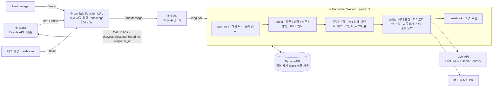

# 설계 대비 구현

기준 설계: 「Slack 요청을 큐로 받아 LLM 워커가 처리하는 구조」(2026-10-11, 손그림 ①~⑥ 정리본). 설계는 기본안(Lambda → FastAPI → SQS)과 단순화안(Lambda → SQS)을 제시하며, 이 구현은 **단순화안**을 따른다.

## 요소별 대조

| 설계 | 구현 | 비고 |
|---|---|---|
| ① Slack Events API 웹훅 | 같음. 버튼 클릭(block_actions)도 같은 서명으로 받음 | |
| ② Lambda: 서명 검증·challenge·3초 내 200 | 같음 | LocalStack 왕복 p95 1.05초 |
| ② 재시도 헤더가 있으면 버림 | **버리지 않고 큐에 넣음.** 중복은 워커가 제거 | 첫 요청이 큐 적재 전에 실패하면 재시도가 유일한 복구 기회라서 |
| 단순화안 중복 제거: SQS FIFO 또는 DynamoDB 조건부 쓰기 | DynamoDB 조건부 쓰기 | FIFO의 5분 창은 늦은 재전달을 막지 못함 |
| ③ SQS 버퍼 + DLQ "3회 실패" | DLQ 기준 **수신 8회** | SQS는 실패가 아니라 수신을 센다. 대기·재시도도 수신을 소모해 3회면 정상 burst가 DLQ로 감 |
| ⑥ long-poll, 동시성 N, 성공 시 DeleteMessage | 같음 + lease·heartbeat | 처리 중 visibility 만료로 인한 중복 실행 방지 |
| ④ pre-hook | 같음 | |
| ④ router (if/else) | 같음 | |
| ④ RAG · ⑤ Vector DB | **넣지 않음.** 대신 근거 수집 단계 | 아래 "RAG를 뺀 이유" |
| ④ skills · 도구 실행 + LLM | 상태 조회, 파이프라인 조회, 되돌리기 PR. LLM은 근거 요약 | 설계가 비워 둔 칸을 장애 대응 도구로 채움 |
| ④ post-hook | 같음 | Slack 문법 이스케이프, 길이 제한, 구조화 로그 |
| LLM API | LiteLLM 게이트웨이 경유 | 서비스별 키·호출 한도·예산 |
| CALLBACK | 같음 | 전송 결과가 불확실하면 자동 재전송하지 않음 |
| 진행 표시(👀) | 워커가 처음 맡을 때 리액션 | 수신 Lambda에 봇 토큰 권한과 3초 안의 추가 호출을 주지 않으려고 워커에서 처리 |
| 서명 secret은 Secrets Manager, 5분 지난 요청 거부 | 같음 | |

## 설계에서 바꾼 판단

**RAG를 뺀 이유.** 장애 대응에서 필요한 근거는 문서가 아니라 정확히 조회되는 데이터였다. 실제 6/30 장애의 원인 단서는 배포 이력이었고, 이는 검색이 아니라 조회로 얻는다. 현업 도구들도 런북은 알림 규칙의 `runbook_url`로 직접 연결하고, 의미 기반 검색은 과거 장애가 수백 건 쌓인 경우에 쓴다. 이 팀의 장애 기록은 몇 건이라 벡터 DB를 둘 근거가 없다. 문서 기반 RAG는 리포트 생성 서비스(5-Agent Agentic RAG)에서 따로 구현했다.

**입력 채널이 넷인데 단순화안을 유지한 이유.** 설계의 비교표는 "웹·크론·다른 메신저 요청을 한곳에 모으거나, 정규화·인증·조회 API처럼 수신 외의 일이 있을 때" 기본안(FastAPI)을 권한다. 지금은 Slack 이벤트, Slack 버튼, Alertmanager, Git webhook 네 가지를 받는다. 다만 넷 모두 "인증 → 작은 Job으로 정규화 → 큐 적재"만 하고 조회 API가 없어서, 같은 Lambda 안의 경로 분기로 충분했다. 사람이 쓰는 조회 API나 웹 입력이 생기면 FastAPI로 분리한다.

**재시도와 DLQ 기준을 바꾼 이유.** 위 표의 비고와 같다. 둘 다 구현하며 실패를 재현해 확인했다.

## 설계에 없던 것

| 추가 | 이유 | 문서 |
|---|---|---|
| 답글 전송 불확실 상태(AMBIGUOUS) | Slack이 받았는지 모르는 실패에서 중복 답글 대신 사람 확인 | [architecture.md](architecture.md) |
| 실패 지점별 재시도(모델에 닿지 않음 / 영구 거절 / 실행 여부 불명) | 게이트웨이 장애가 모델 시도 횟수를 소모하지 않게 | [gateway-verification.md](gateway-verification.md) |
| 되돌리기 PR과 Git webhook | 실제 장애의 해결책이 Git 변경이었고, 배포가 ArgoCD로 이뤄짐 | [gitops-verification.md](gitops-verification.md) |
| 승인·실행 기록·RBAC | 실행 권한을 가진 봇의 통제 | [chatops-verification.md](chatops-verification.md) |
