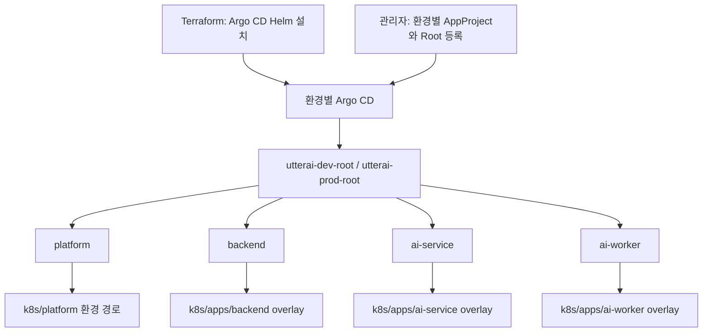

# UtterAI App of Apps 전환

## 결정과 범위

환경별 정적 Root로 기존 Application 4개를 편입한다. Application의 이름·namespace·spec과 실제 워크로드 경로는 유지한다. ApplicationSet은 환경/클러스터 조합을 동적으로 생성할 필요가 생길 때 다시 비교한다. 이번 단계는 Application 등록과 관리 책임의 전환이다. 성능 개선, 의존성 차단, 무중단 배포를 이 구조만으로 보장하지 않는다.



- Root source: `deploy/argocd/{dev,prod}`. Kustomization에 Child 4개를 명시한다. 재귀 검색하지 않는다.
- Bootstrap source: `deploy/argocd/bootstrap/{dev,prod}`. Root와 AppProject만 포함하며 Root가 자신을 관리하지 않는다.
- `infra-lab/capacity-lab.yaml`은 Root 대상에서 제외한다.
- Terraform은 Argo CD 설치를 유지한다. Add-on의 Terraform → Argo CD 소유권 이동은 하지 않는다.
- 각 Root는 해당 환경 클러스터의 Argo CD에 등록한다. 중앙 Argo CD·다중 클러스터 구성을 전제로 하지 않는다. 실제 환경이 다르면 destination부터 재설계한다.

## 배포 정책

| 대상 | 기존 자동 sync | 전환 후 |
| --- | --- | --- |
| dev Child 4개 | prune/selfHeal 활성 | 동일 |
| prod backend/ai-service/ai-worker | 수동 | 동일 |
| prod platform | prune/selfHeal 활성 | 동일 |
| dev/prod Root | 신규 | 수동, 자동 prune 없음, finalizer 없음 |

App of Apps 최초 편입 단계에서는 Child YAML 원본을 수정하지 않았다. 이후 kind 정책 검증을 거쳐 replica 소유권과 경로 annotation을 개선했다. 상세 변경과 결과는 [운영 정책 검증](operations-validation.md)을 참조한다. 환경별 Kustomization이 `Prune=false,Delete=false` annotation만 추가한다. 이 보호는 **Parent가 Child 리소스를 prune/삭제하는 동작**에 적용된다. Child 자체의 워크로드 prune 정책을 끄는 설정은 아니다. 관리자가 Application을 직접 삭제하거나 finalizer를 추가하는 모든 동작을 차단하는 보안 장치도 아니다.

Root 프로젝트는 해당 Git 저장소, 로컬 `argocd` namespace, `Application` 종류만 허용하고 클러스터 리소스를 금지한다. 그러나 Child의 project/source/destination을 수정할 수 있는 관리 기능이므로 tenant 격리 경계로 간주하지 않는다. Root·Child 경로와 bootstrap project 변경 권한은 인프라 관리자에게 제한하고 PR 검토 대상으로 둔다. 기존 Child의 `default` project는 이번 단계에서 유지한다.

Root의 Synced/Healthy는 서비스 가용성이나 모든 Child의 Healthy를 보장하지 않는다. 자식 Application health customization과 Sync Wave는 이번 전환에 추가하지 않는다.

## 사전 확인

1. 리뷰한 변경이 GitHub `main`에 반영된 뒤 Root를 등록한다. Root가 main을 보므로 로컬 파일만 만든 상태에서 sync하지 않는다.
2. dev/prod context와 실제 클러스터 endpoint를 각각 확인한다. 기본 context는 사용하지 않는다.
3. 기존 Child 4개와 spec을 확인한다. 기존 dev 스크립트는 ai-service를 등록하지 않았으므로 실제로 없을 수 있다. 이 경우 전환 도구는 중단한다. ai-service의 신규 배포를 따로 검토하고 등록한 뒤 다시 실행한다.
4. 다른 Application/ApplicationSet/Terraform/외부 자동화가 같은 Child 정의를 관리하는지 조사하고 기존 writer를 정리한다. kubectl에 드러나지 않는 외부 자동화는 도구가 자동 판별하지 못한다.
5. Child가 동기화 중이거나 삭제 중이면 기다린다. 예상치 못한 drift, finalizer, ownerReference, 기존 Parent tracking이 있으면 전환 전에 검토한다.

## 등록 절차

저장소 루트에서 실행한다. Python 3.9 이상과 kubectl이 필요하다.

```bash
python3 -m pip install -r scripts/gitops/requirements.txt
bash scripts/k8s-dev-bootstrap-argocd.sh \
  --context arn:aws:eks:ap-northeast-2:032886669461:cluster/utterai-dev-eks
```

기본 동작은 읽기 전용 preflight다. Child가 없거나 spec이 Git과 다르면 중단한다. finalizer/ownerReference/다른 Parent tracking/진행 중 operation도 거부한다. Child를 새로 만들거나 수정하지 않는다.

통과 후 등록한다. snapshot에는 Application metadata/spec만 저장하며 Secret을 수집하지 않는다. 기존 파일 덮어쓰기와 저장소 내부 경로는 허용하지 않는다.

```bash
bash scripts/k8s-dev-bootstrap-argocd.sh \
  --context arn:aws:eks:ap-northeast-2:032886669461:cluster/utterai-dev-eks \
  --apply --snapshot /private/tmp/utterai-dev-before-app-of-apps.json
```

`--apply`는 remote main SHA와 로컬 배포 파일이 일치하는지도 검사한다. remote SHA 객체가 로컬에 없으면 `git fetch origin main` 후 재실행한다. 등록은 AppProject → Root 순서다. Root sync는 시작하지 않는다. 등록 중 실패하면 일부 리소스가 등록됐을 수 있으므로 확인한 뒤 재실행한다.

Argo CD UI/CLI가 **같은 dev 클러스터**를 가리키는지 확인하고 Root diff를 검토한다.

```bash
argocd app diff utterai-dev-root
argocd app sync utterai-dev-root
```

`--prune`은 사용하지 않는다. diff에는 Child 정의의 새 tracking/보호 annotation 외에 의도하지 않은 spec 변경이 없어야 한다. Root를 sync하면 기존 Child의 자동화가 작동할 수 있으므로 등록 전부터 Git/live spec을 맞춰 둔다. 동시 Git 변경을 멈추고 리뷰한 revision을 확인한다.

전환 후 Child UID, spec, tracking, Deployment spec, Pod UID를 전환 전 기록과 대조한다. 외부 스케일링·rollout이 동시에 있었다면 Pod 변화 원인을 별도로 확인한다. Root 상태와 별개로 Child health와 실제 워크로드 상태를 확인한다.

prod는 dev 결과 확인 후 같은 절차로 `k8s-prod-bootstrap-argocd.sh`와 prod context를 사용한다. prod platform이 자동 sync라는 사실은 유지되므로 Root가 수동이라는 이유로 모든 prod 워크로드가 수동이라고 판단하지 않는다.

## 개별 Application 관리로 복귀

1. Root에 진행 중 operation이 없음을 확인한다. Root가 계속 Child spec을 적용하는 상태에서 Child를 되돌리지 않는다.
2. Root에 cascading finalizer가 없음을 확인한다. 있다면 임의로 삭제하지 말고 원인과 삭제 동작을 먼저 검토한다.
3. 해당 context를 명시해 Root만 비연쇄 삭제한다.

```bash
kubectl --context "$DEV_CONTEXT" -n argocd delete application utterai-dev-root --cascade=orphan
```

4. Child UID와 워크로드가 유지되는지 확인한다. 각 Child의 **Root 소유 tracking annotation/instance label만** 제거한다. Child 아래 워크로드의 tracking은 변경하지 않는다. `kubectl.kubernetes.io/last-applied-configuration`을 비롯한 다른 annotation을 일괄 삭제하지 않는다.
5. 승인된 기존 개별 YAML을 `kubectl --context ... apply -f deploy/argocd/dev/<child>.yaml`로 다시 적용한다. snapshot 원본은 비교 자료다. UID/resourceVersion/status를 포함한 snapshot JSON을 그대로 apply하지 않는다.
6. Child와 워크로드 상태를 확인한다. 다른 Application이 사용하지 않는지 확인한 뒤 bootstrap AppProject를 필요 시 정리한다.

Root를 단순 재등록하면 Git의 Child 정의가 다시 관리 대상이 되므로 복귀 기간 동안 Root를 자동 재생성하는 외부 자동화도 중단한다.

## 검증 실행

```bash
python3 -m unittest discover -s tests/gitops -p 'test_*.py' -v
bash -n scripts/k8s-dev-bootstrap-argocd.sh scripts/k8s-prod-bootstrap-argocd.sh
```

로컬 통합 실험은 별도 `kind-utterai-gitops`에서만 실행되며 원래 EKS용 source 대신 내부 Git 서버와 nginx 모의 Deployment를 사용한다. dev/prod Child의 sync 정책과 Root 구조는 유지한다. Terraform 차트 9.5.20의 appVersion인 Argo CD v3.4.3을 사용한다.

```bash
kind create cluster --name utterai-gitops --image kindest/node:v1.31.9 \
  --kubeconfig /private/tmp/utterai-gitops.kubeconfig
kubectl --kubeconfig /private/tmp/utterai-gitops.kubeconfig --context kind-utterai-gitops create namespace argocd
kubectl --kubeconfig /private/tmp/utterai-gitops.kubeconfig --context kind-utterai-gitops -n argocd \
  apply --server-side -f https://raw.githubusercontent.com/argoproj/argo-cd/v3.4.3/manifests/core-install.yaml
# nginx:alpine을 로컬에 준비한 뒤 kind에 로드한다.
kind load docker-image nginx:alpine --name utterai-gitops
python3 tests/gitops/local.py --kubeconfig /private/tmp/utterai-gitops.kubeconfig \
  --output /private/tmp/utterai-app-of-apps-result.json
```

실험은 리뷰를 위해 로컬 클러스터와 내부 Git 컨테이너를 남긴다. 재실행은 이전 fixture를 정리한 새 클러스터에서 한다. 기본 kubeconfig와 EKS에는 접근하지 않는다.

```bash
docker rm -f utterai-gitops-git
kind delete cluster --name utterai-gitops --kubeconfig /private/tmp/utterai-gitops.kubeconfig
```

## 근거

- [Argo CD Cluster Bootstrapping](https://argo-cd.readthedocs.io/en/stable/operator-manual/cluster-bootstrapping/): App of Apps와 관리자 권한, ApplicationSet 대안.
- [Argo CD Sync Options](https://argo-cd.readthedocs.io/en/stable/user-guide/sync-options/): Prune=false, Delete=false, FailOnSharedResource.
- [Argo CD Projects](https://argo-cd.readthedocs.io/en/stable/user-guide/projects/): 리소스 종류와 destination 제한.

## 이번 실행 결과

- 실행 시각·버전·Git revision·리소스 UID: [로컬 통합 실험 원본](evidence/app-of-apps-local.json).
- 정적/전환 도구 검증: 14개 통과. [검증 범위와 코드 해시](evidence/verification.json).
- Argo CD v3.4.3 Core, kind Kubernetes v1.31.9, Gitea 1.22.6, nginx 모의 워크로드 사용.
- 로컬 kubectl v1.36과 서버 v1.31의 minor version skew 경고가 있었다. 아래 결과는 이 로컬 환경에서 관찰한 동작이며 EKS 버전 호환성 검증을 대체하지 않는다. CI kubectl은 v1.31.9로 고정했다.

| 실험 | dev fixture | prod fixture |
| --- | --- | --- |
| 기존 Application/Deployment/Pod UID 유지 | 통과 | 통과 |
| 기존 Child spec 및 자동/수동 정책 보존 | 통과 | 통과 |
| 단일 Child source revision 변경 시 다른 Child spec 유지 | 통과 | 통과 |
| Child 제거 커밋에 명시적 prune 요청: PruneSkipped 확인 | 통과 | 통과 |
| 비연쇄 Root 삭제 후 Child/워크로드 보존 | 통과 | 통과 |
| Root tracking 해제 후 개별 apply 복귀 시 UID 유지 | 통과 | 통과 |
| Root 재등록 및 재편입 | 통과 | 통과 |

통합 실험은 배포 YAML을 렌더링한 뒤 테스트 Git source와 모의 워크로드로 치환하여 실제 Argo CD에서 실행했다. 전환 도구의 snapshot 권한, 등록 순서, 원격 main 확인 실패와 preflight 거부 조건은 unit/mock 테스트로 확인했으며, 이 도구를 통한 EKS 등록 성공을 검증한 것은 아니다.

실제 EKS는 dev/prod kubeconfig에 저장된 API endpoint 모두 DNS 조회에 실패하여 읽기 전용 preflight부터 중단됐다. EKS에는 apply/sync를 수행하지 않았다. 또한 Root가 참조할 파일은 아직 로컬 작업 트리에만 있으므로 실제 등록 전 main 반영이 필요하다. 현재 EKS 리소스나 접속 주소가 무엇인지는 이 실패만으로 단정할 수 없다.

검증용 `kind-utterai-gitops`와 `utterai-gitops-git` 컨테이너는 리뷰용으로 남겨 두었다. 다른 `slack-ops` 클러스터와 기본 kubeconfig의 current context는 변경하지 않았다.
