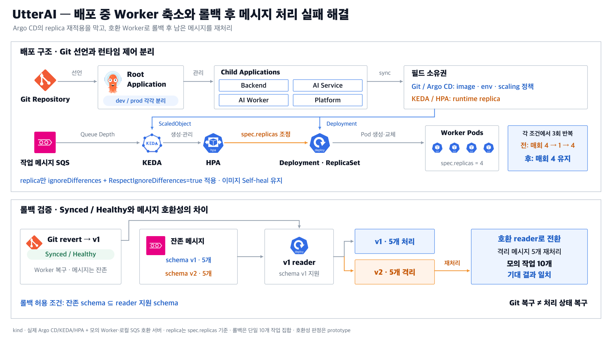

## 1. 제목

**UtterAI - 배포 중 Worker 축소와 롤백 후 메시지 처리 실패 해결**

## 2. 한 줄 요약

**Argo CD의 replica 재적용을 막고, 호환 Worker로 롤백 후 남은 메시지를 재처리.**

## 3. 문제·원인

- **배포 중 Worker 축소:** KEDA/HPA가 replica를 4로 확장해도 Argo CD가 Git에 선언된 1을 다시 적용해, 동기화 중 수량이 일시 축소. `ignoreDifferences`만으로는 동기화 시 재적용을 막지 못함.
- **정상 롤백 후 처리 실패:** Worker를 이전 버전으로 되돌린 뒤 Argo CD는 Synced/Healthy로 표시됐지만, 큐에 남은 신형 메시지는 구형 Worker가 읽지 못해 격리.

## 4. 해결 과정

- 기존 서비스별 Application을 환경별 Root로 관리하고, Child별 배포 정책과 삭제 보호 경계 유지.
- 오토스케일 대상의 replica에만 `ignoreDifferences`와 `RespectIgnoreDifferences=true`를 함께 적용. 런타임 수량은 KEDA/HPA가 제어하고, 이미지 등 배포 설정은 Argo CD가 복구하도록 분리.
- 구·신 메시지를 남긴 상태에서 실제 Git revert 수행. 두 형식을 읽을 수 있는 호환 Worker로 전환한 뒤 격리 메시지를 재처리하고 작업별 결과 확인.

## 5. 결과

- **배포 중 수량 보존:** 각 설정으로 동기화를 세 번 반복. 변경 전에는 매번 replica가 4에서 1로 줄었다가 4로 복원됐고, 변경 후에는 세 번 모두 4를 유지. 이미지 수동 변경에 대한 Self-heal도 확인.
- **롤백 후 처리 복구:** 구형 Worker가 처리하지 못한 신형 메시지 5개를 재처리하고, 구형 메시지 5개를 포함한 모의 작업 10개의 결과가 모두 기대값과 일치함을 확인.
- **Root 변경 시 리소스 보존:** Root 삭제·복원 과정에서 Child·Deployment·Pod UID 유지 확인.

*kind의 실제 Argo CD·KEDA·HPA와 모의 워크로드로 검증. replica는 Deployment spec.replicas 기준. 메시지 복구 결과는 단일 10개 작업 집합 기준이며, 롤백 호환성 판정 코드는 prototype.*
